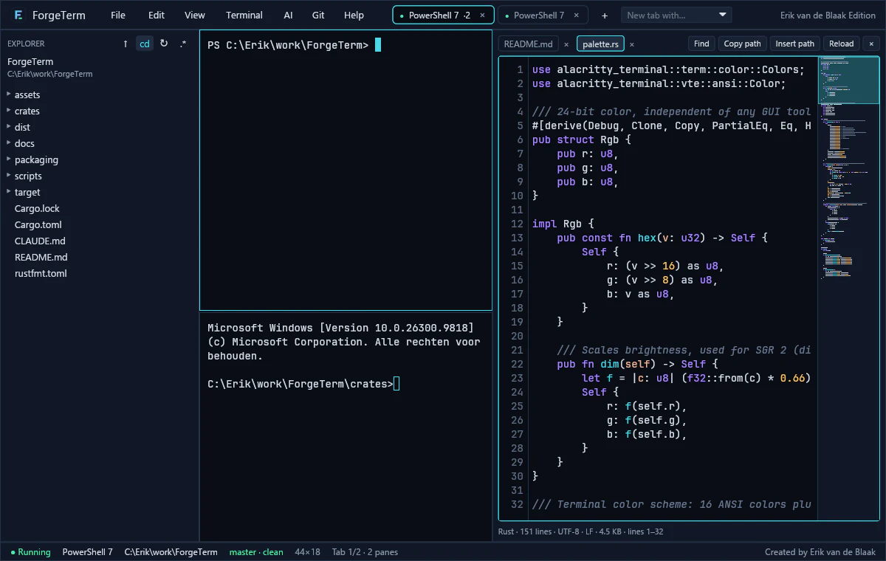
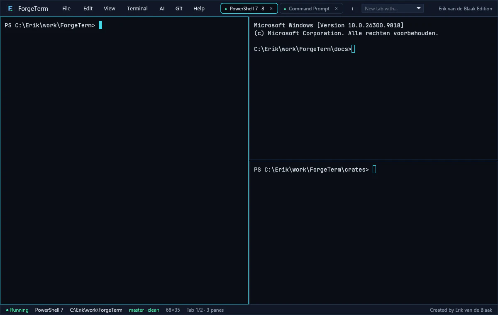

<p align="center">
  
</p>

<h1 align="center">ForgeTerm</h1>

<p align="center">
  <strong>A GPU-rendered terminal for Windows 11 and Linux, built for programming with AI coding agents like Claude Code and Codex.</strong><br>
  Written in Rust. Tabs, splits, a file explorer, a code viewer, a Git panel and a Prompt Studio, in one window.
</p>

<p align="center">
  <a href="https://github.com/erikvandeblaak/ForgeTerm/releases/latest"></a>
  <a href="#license"></a>
  
  
</p>

<p align="center">
  <a href="https://www.vandeblaak.com/downloads/?lang=en">Download</a> ·
  <a href="#features">Features</a> ·
  <a href="#keyboard-shortcuts">Shortcuts</a> ·
  <a href="#building-from-source">Build</a> ·
  <a href="docs/ARCHITECTURE.md">Architecture</a> ·
  <a href="README.nl.md">Nederlands</a>
</p>



## Why ForgeTerm

A terminal that runs AI agents has to be predictable. ForgeTerm puts the tools you use next to an agent (files, code, Git, your prompts) beside the terminal, and keeps you in control of what runs:

- **Nothing runs by itself.** Text that ForgeTerm puts in the terminal (a pasted prompt, a path, the output of the last command) never gets an Enter. You decide when it runs.
- **ForgeTerm never sends a prompt to an agent.** Terminal and agent output is treated as data, not as instructions.
- **Safe in unknown repositories.** Git never starts programs a repository configures (no fsmonitor, external diff or textconv) and the background status takes no `index.lock`.
- **No fake features.** What is not measured (for example the GPU) is shown as *not measured*.

## Features

| | |
|---|---|
| **GPU-rendered terminal** | ConPTY on Windows and a real PTY on Linux, with the VT emulation of [alacritty_terminal](https://github.com/alacritty/alacritty). Truecolor, 256 colours, alt screen for vim, CJK characters, the Kitty keyboard protocol (so Shift+Enter gives a new line in Claude Code). JetBrains Mono. |
| **Tabs and splits** | Side by side or stacked, drag the divider, maximise one pane. Each tab picks its own shell: PowerShell 7, Windows PowerShell, cmd, Git Bash, WSL, bash. |
| **Command Palette** | Ctrl+Shift+P lists every action with fuzzy search. The same actions are in the menu bar, and every shortcut can be changed in `settings.toml`. |
| **AI workspace** | Finds Claude Code and Codex, shows their version and starts them in the project root as a tab or split. Shows the project context: `CLAUDE.md`, `AGENTS.md`, rules, skills, commands, subagents and MCP. |
| **Prompt Studio** | Templates with `{{variables}}`. ForgeTerm fills in what it actually knows (project, folder, selected text, file) and inserts the prompt without an Enter. Floating, or docked beside the terminal. Your own templates are plain `.md` files. |
| **Shell integration** | Every prompt gets a mark in the margin (succeeded, failed, running). Jump between commands with Ctrl+Shift+↑/↓, copy the output of the last command, or put it in your agent's prompt. Never touches your profile or rc files. |
| **Code viewer** | Read-only viewer with syntax highlighting, line numbers, a minimap, search and copy. Ctrl+click on `src/main.rs:42`, `Program.cs(12,5)` or a Python traceback in the output opens the file at that line. |
| **Git panel** | Branch, ahead/behind and changes in the status bar. Diff, stage, unstage, commit, switch branches, history, and commits per day over thirty days. Push and pull are deliberately left to the terminal. |
| **Explorer and session** | A file tree that follows your shell's folder, usable by keyboard. Double-click puts the path in the terminal, quoted correctly for that shell. Tabs, splits and folders come back at the next start. |
| **Monitor** | CPU and memory of the system and of each terminal's whole process tree, with three minutes of history. |
| **Tab badges** | A tab shows *needs you*, *done*, *failed*, *working* or *bell* when a program asks for attention; the taskbar flashes when the window is in the background. |



## Install

Download the latest version from the [releases page](https://github.com/erikvandeblaak/ForgeTerm/releases/latest) or from [vandeblaak.com/downloads](https://www.vandeblaak.com/downloads/?lang=en). Every file comes with a `.sha256` file.

**Windows 11 (x64)**

- `ForgeTerm-<version>-setup-x64.exe` installs per user to `%LOCALAPPDATA%\Programs\ForgeTerm`, without administrator rights, with a Start menu shortcut and an entry under *Settings › Apps*. The installer is not signed yet, so SmartScreen says *Unknown publisher*: choose *More info › Run anyway* after checking the hash.
- `ForgeTerm-<version>-windows-x64.zip` is the portable version: unzip and start `forgeterm.exe`.

```powershell
Get-FileHash .\ForgeTerm-0.1.1-setup-x64.exe -Algorithm SHA256
```

**Linux Mint 22 / Ubuntu 24.04 (amd64)**

```bash
sha256sum -c forgeterm_0.1.1-1_amd64.deb.sha256
sudo apt install ./forgeterm_0.1.1-1_amd64.deb      # remove: sudo apt remove forgeterm
```

apt installs the missing libraries itself (X11/Wayland, xkbcommon, EGL). Git and Vulkan are recommended.

There is no macOS version.

## Keyboard shortcuts

| Action | Keys |
|---|---|
| Command Palette | Ctrl+Shift+P |
| New tab / tab with shell N | Ctrl+Shift+T / Ctrl+Shift+1…9 |
| Go to tab N, next / previous tab | Alt+1…9, Ctrl+Tab / Ctrl+Shift+Tab |
| Split side by side / stacked | Alt+Shift+= / Alt+Shift+- |
| Move focus between panes | Alt+arrow keys |
| Maximise pane and back | Ctrl+Shift+Enter |
| Close pane | Ctrl+Shift+W |
| Previous / next command | Ctrl+Shift+↑ / ↓ |
| AI workspace | Ctrl+Shift+A |
| Prompt Studio | Ctrl+Shift+I |
| Explorer | Ctrl+Shift+E |
| Code viewer | Ctrl+Shift+O |
| Git panel | Ctrl+Shift+G |
| Monitor | Ctrl+Shift+M |
| Search output and scrollback | Ctrl+Shift+F |
| Copy / paste | Ctrl+C with a selection, Ctrl+Shift+C / Ctrl+V, Ctrl+Shift+V, Shift+Insert |
| Font size | Ctrl+= / Ctrl+- / Ctrl+0 |
| Open settings | Ctrl+, |

The full list, with every detail, is in the [Dutch manual](README.nl.md#sneltoetsen) and in *Help › Keyboard Shortcuts* inside ForgeTerm.

## Settings

ForgeTerm reads `%APPDATA%\ForgeTerm\settings.toml` on Windows and `~/.config/forgeterm/settings.toml` on Linux (or the file in `FORGETERM_SETTINGS`). Ctrl+, creates the file with an explanation per setting and opens it; saved changes apply within about two seconds. Mistakes show up in a bar at the top and that setting falls back to its default. ForgeTerm never writes to an existing settings file.

| Setting | Default | Meaning |
|---|---|---|
| `terminal.font_size` | 14 | 8–32 |
| `terminal.scrollback` | 10000 | lines per terminal (0–100000) |
| `terminal.default_shell` | first one found | name as in *New tab with…*, e.g. `"Git Bash"` |
| `terminal.start_directory` | ForgeTerm's start folder | folder of the first tab |
| `terminal.shell_integration` | true | shells report their folder and mark prompts and commands |
| `explorer.visible` / `follow_terminal` / `show_hidden` | false / true / false | explorer |
| `[keys]` | (empty) | your own shortcuts: `"Ctrl+K" = "command_palette"`, `= "none"` removes a default |
| `workspace.restore_session` | true | restore tabs, splits, folders and viewer files at start |

## Building from source

Requirements: Rust 1.88 or newer (stable). On Windows also the Visual Studio C++ Build Tools and the Windows SDK.

```bash
git clone https://github.com/erikvandeblaak/ForgeTerm.git
cd ForgeTerm
cargo run --release
```

Quality gate before a change counts as done:

```bash
cargo fmt --all -- --check
cargo clippy --workspace --all-targets -- -D warnings
cargo test --workspace
```

Packages: `pwsh scripts\package-windows.ps1` builds the zip and, with [NSIS 3](https://nsis.sourceforge.io), the installer. `bash scripts/package-linux.sh` builds the `.deb` (needs `cargo-deb` and `dpkg-dev`).

### Project layout

ForgeTerm is a Cargo workspace of nine crates. The terminal engine contains no GUI code, so it can be tested on its own, and the workspace denies `unsafe` code apart from two documented places.

| Crate | Purpose |
|---|---|
| `forgeterm-terminal` | session (PTY + emulator), input encoding, palette, shell detection, path quoting per shell |
| `forgeterm-app` | the [iced](https://github.com/iced-rs/iced) application, canvas renderer, theme |
| `forgeterm-agents` | find Claude Code and Codex, versions, project context (read only) |
| `forgeterm-prompts` | Prompt Studio templates and variables |
| `forgeterm-git` | Git through the CLI (porcelain v2) with safe fixed options |
| `forgeterm-viewer` | file loading, syntax highlighting (syntect), search |
| `forgeterm-explorer` | file tree; never changes the file system |
| `forgeterm-settings` | `settings.toml`: tolerant loading, template |
| `forgeterm-system` | CPU and memory per terminal (sysinfo, read only) |

More in [docs/ARCHITECTURE.md](docs/ARCHITECTURE.md), [docs/ROADMAP.md](docs/ROADMAP.md) and [docs/TEST_PLAN.md](docs/TEST_PLAN.md) (in Dutch).

## Status and known limitations

ForgeTerm is young (version 0.1). Tested on Windows 11 with PowerShell 7, Windows PowerShell, cmd, Git Bash, Claude Code and Codex. Linux is built and tested in WSL with Ubuntu 24.04, the base of Linux Mint 22, but not yet on a real Mint desktop.

- The installer is not code-signed.
- One theme (Forge Dark) and no font choice yet.
- Emoji are monochrome.
- No IME (Chinese or Japanese input). Dead keys (US-International) do work.
- No macOS version.

The complete, honest list is in [docs/ROADMAP.md](docs/ROADMAP.md#bekende-beperkingen-eerlijk).

## Contributing

Bug reports and ideas are welcome in the [issues](https://github.com/erikvandeblaak/ForgeTerm/issues). Read [CONTRIBUTING.md](CONTRIBUTING.md) before opening a pull request. Security problems: see [SECURITY.md](SECURITY.md).

## License

ForgeTerm is licensed under either of

- [Apache License, Version 2.0](LICENSE-APACHE)
- [MIT license](LICENSE-MIT)

at your option. Unless you explicitly state otherwise, any contribution intentionally submitted for inclusion in ForgeTerm by you, as defined in the Apache-2.0 license, shall be dual licensed as above, without any additional terms or conditions.

Third-party: JetBrains Mono (SIL Open Font License 1.1, `assets/fonts/JetBrainsMono-OFL.txt`), iced (MIT), alacritty_terminal (Apache-2.0). Release packages include `THIRD-PARTY.txt` with the license of every compiled-in crate.

## Author

Made by **Erik van de Blaak**, AI Solutions Engineer and full-stack developer in the Netherlands.
[vandeblaak.com](https://www.vandeblaak.com/?lang=en) · [ForgeTerm downloads](https://www.vandeblaak.com/downloads/?lang=en)
